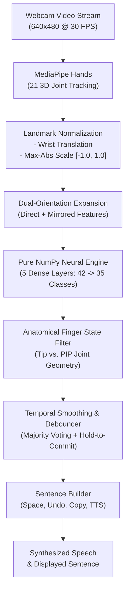

# 🤟 Indian Sign Language (ISL) Recognition & Translation Platform

[](https://www.python.org/)
[](https://fastapi.tiangolo.com/)
[](https://developers.google.com/mediapipe)
[](https://opencv.org/)
[](https://pytest.org/)
[](LICENSE)

An AI-powered, real-time Indian Sign Language (ISL) recognition and assistive translation platform. Designed to bridge the communication divide between deaf or hard-of-hearing individuals and non-signers, this system converts real-time webcam sign gestures into readable text and synthesized speech, while providing reverse Text-to-Sign instructional guides.

The application is deployed across **two interfaces**:
1. 🌐 **Full-Stack Web Application (`app.py`):** Real-time browser webcam streaming, canvas skeleton overlay, sentence construction buffer, assistive shortcut phrases, and Text-to-Speech (TTS) synthesis.
2. 🖥️ **Desktop OpenCV Application (`isl_detection.py`):** High-speed desktop window featuring an on-screen Heads-Up Display (HUD) and interactive keyboard hotkeys.

---


---

## 📑 Table of Contents

- [Problem Statement & Objectives](#-problem-statement--objectives)
- [Key Features](#-key-features)
- [System Architecture & Pipeline](#-system-architecture--pipeline)
- [Project Directory Structure](#-project-directory-structure)
- [Getting Started](#-getting-started)
  - [Prerequisites & Installation](#1-prerequisites--installation)
  - [Running the Web Application](#2-running-the-web-application-recommended)
  - [Running the Desktop OpenCV Application](#3-running-the-desktop-opencv-application)
- [Dataset Collection & Training Utility](#-dataset-collection--training-utility)
- [Empirical Model Evaluation & Benchmark](#-empirical-model-evaluation--benchmark)
- [REST API Reference](#-rest-api-reference)
- [Project Contributors](#-project-contributors)
- [Ethical Disclosure & Disclaimer](#-ethical-disclosure--disclaimer)

---

## 🎯 Problem Statement & Objectives

Indian Sign Language (ISL) is used by millions of individuals across India. Unlike American Sign Language (ASL) or British Sign Language (BSL), ISL possesses its own unique grammatical syntax, two-handed fingerspelling alphabets, and regional signing conventions. Most hearing individuals do not understand sign language, creating communication hurdles in education, healthcare, public transport, and workplace environments.

### Core Objectives:
- **Real-Time Perception:** Track anatomical hand keypoints at 30+ FPS using standard consumer webcams without specialized sensory gloves.
- **Orientation Invariance:** Reliably recognize gestures whether performed with the left hand, right hand, or via mirrored selfie cameras.
- **False-Positive Suppression:** Reject invalid gesture transitions and prevent OOD (out-of-distribution) collapse into sink classes (e.g., preventing multi-finger gestures from falsely predicting 'Z').
- **Sentence Assembly:** Provide an adaptive debounced phrase buffer with hold-to-commit logic, manual typing, space, backspace, and clear controls.
- **Bidirectional Communication:** Combine forward Sign-to-Speech (TTS) and reverse Text-to-Sign reference lookup in a unified interface.

---

## 🌟 Key Features

### 1. Two-Stage Perception & Vectorized Inference
- **Stage 1 (Joint Perception):** Uses Google MediaPipe Hands to extract 21 3D hand landmarks $(x, y, z)$.
- **Stage 2 (Geometric Normalization):**
  - *Translation Invariance:* Anchors all 21 points relative to the wrist origin $(x_0, y_0)$.
  - *Scale Invariance:* Normalizes coordinates by the maximum absolute magnitude into $[-1.0, 1.0]$ with zero-division guards.
- **Stage 3 (Pure NumPy Inference):** Weights extracted from `model.h5` are executed through a pure NumPy vectorized forward pass, achieving **0.14 ms / frame** latency (~7,100 inferences/sec on CPU) with zero heavy TensorFlow runtime overhead.

### 2. Dual-Orientation Invariance & Anatomical Validation
- Evaluates both direct spatial features and their horizontal reflection ($x \to -x$).
- Validates predicted classes against MediaPipe anatomical finger extension states (e.g., verifying that a 3-finger gesture maps to digit `'3'` rather than an OOD mirror artifact like `'Z'`).
- Supports both left-handed and right-handed signers seamlessly.

### 3. Debounced Sentence Construction Buffer
- Temporal majority voting over a sliding window (70% consistency agreement).
- Hold-to-commit debouncer: gestures must be held steady for ~1.5–2.0 seconds to commit, suppressing wobble artifacts.
- Post-commitment lock: requires hand release before re-committing identical letters.
- UI Auto-Type toggle switch and manual `[➕ Commit Sign]` button / `[Enter]` hotkey.

### 4. Communication Phrase Shortcuts
- Quick one-click insertion of essential everyday communication phrases (*Hello, Thank You, Please, Sorry, Yes, No, How are you?, I need water, Help me*).
- Clearly identified as UI assistive shortcuts to prevent confusing phrase insertions with camera-recognized gestures.

### 5. Reverse Text-to-Sign Visual Catalog
- Searchable reference dictionary mapping letters and words to authentic ISL demonstration photos.
- 35 cropped individual sign demonstration guides with filters for **Test-Validated Signs (`A`, `B`, `C`)** and **Reference Guides (`D`–`Z`, `1`–`9`)**.

### 6. Voice Synthesis (TTS)
- Integrated browser SpeechSynthesis API enables instant voice playback of composed sentences with natural pacing.

---

## 🔄 System Architecture & Pipeline




---

## 📂 Project Directory Structure

```
Indian-Sign-Language-Detection/
├── core/
│   ├── __init__.py
│   ├── landmark_processor.py   # Coordinate scaling, wrist translation, zero-division guards
│   ├── model_engine.py         # Sub-millisecond NumPy forward-pass engine with invariant inference
│   ├── phrase_buffer.py        # Sentence assembly, hold-to-commit debouncer, suggestions bank
│   ├── reference_catalog.py    # Reverse text-to-sign catalog & 35-sign demonstration gallery
│   └── vocabulary.py           # Explicit registry separating ML signs from UI shortcuts
├── api/
│   ├── __init__.py
│   └── routes.py               # REST API endpoints (health, predict, phrase, reference, capabilities)
├── static/
│   ├── css/style.css           # Modern dark-mode accessible stylesheet
│   ├── js/app.js               # Web frontend controller (video streaming, TTS, canvas HUD)
│   ├── reference/              # 35 individual sign demonstration images (1.png - Z.png)
│   └── index.html              # Full-featured web application interface
├── tests/
│   ├── test_preprocessing.py   # Geometric invariance and landmark unit tests
│   ├── test_model_engine.py    # Neural forward pass dimensions and probabilities
│   ├── test_phrase_buffer.py   # Debouncing and sentence buffer tests
│   └── test_api.py             # FastAPI integration tests
├── images/
│   ├── allGestures.png         # Reference chart of all 35 ISL gestures
│   ├── process.png             # Architectural pipeline flowchart
│   ├── example1.png            # Desktop detection HUD sample 1
│   └── example2.png            # Desktop detection HUD sample 2
├── app.py                      # FastAPI web server entry point (port 8000)
├── isl_detection.py            # Standalone Desktop OpenCV HUD pipeline
├── collect_dataset.py          # Interactive CLI webcam landmark capture utility
├── evaluate_model.py           # Quantitative held-out evaluation & latency benchmark
├── train_classifier.py         # Reproducible classifier training (MLP vs Random Forest)
├── keypoint.csv                # Extracted landmark dataset (7,669 samples)
├── model.h5                    # Pre-trained 35-class neural network weights
├── evaluation_report.json      # Machine-readable evaluation report
└── requirements.txt            # Project dependencies
```

---

## 🚀 Getting Started

### 1. Prerequisites & Installation

Ensure **Python 3.10+** is installed on your system.

```bash
# 1. Clone the repository
git clone https://github.com/MaitreeVaria/Indian-Sign-Language-Detection.git
cd Indian-Sign-Language-Detection

# 2. Create a virtual environment (recommended)
python -m venv venv
venv\Scripts\activate       # On Windows
# source venv/bin/activate  # On macOS / Linux

# 3. Install dependencies
pip install mediapipe==0.10.14 opencv-python numpy pandas h5py scikit-learn fastapi uvicorn pytest requests
```

---

### 2. Running the Web Application (Recommended)

To start the full-featured web platform:

```bash
python app.py
```

Open your browser and navigate to:
👉 **`http://localhost:8000`**

#### Web Features:
- Click **"Start Webcam"** to grant camera permissions and start recognition.
- Real-time **cyan/green skeleton bones and joints** track your fingers on the video canvas.
- Hold any recognized sign steadily for ~2.0 seconds to commit it, or click **"➕ Commit Sign"** / press `Enter` to commit manually.
- Use **"Auto-type character on 2-second steady hold"** checkbox to toggle between automatic and manual typing.
- Click **"🔊 Speak (TTS)"** to hear your constructed sentence spoken aloud.
- Use the **Visual Sign Guide** tab to search and view verified ISL sign demonstration photographs.

---

### 3. Running the Desktop OpenCV Application

To run the standalone lightweight desktop window:

```bash
python isl_detection.py
```

#### Desktop Hotkeys:
| Key | Action |
| :--- | :--- |
| `[SPACE]` | Append word separator space |
| `[BACKSPACE]` | Undo / delete last letter |
| `[C]` | Clear sentence buffer |
| `[Q]` or `[ESC]` | Exit program |

---

## 📊 Dataset Collection & Training Utility

The repository includes a standalone utility to capture verified MediaPipe landmark data directly from your webcam without modifying application source code:

```bash
# 1. Inspect current dataset class distribution and health
python collect_dataset.py --inspect

# 2. Record 50 verified samples for class 'D'
python collect_dataset.py --class-name D --samples 50

# 3. Launch interactive CLI menu
python collect_dataset.py
```

### Training & Benchmarking Alternative Classifiers

To train a Multi-Layer Perceptron (MLP) and Random Forest classifier on `keypoint.csv`:

```bash
python train_classifier.py
```
*Evaluates both architectures and exports the best-performing model to `artifacts/best_randomforest_model.joblib`.*

---

## 📈 Empirical Model Evaluation & Benchmark

Model evaluation is performed strictly on an **80/20 stratified held-out test split** (1,534 isolated test samples) via [`evaluate_model.py`](file:///c:/Users/Sourish/Documents/Projects/Indian-Sign-Language-Detection/evaluate_model.py):

```bash
python evaluate_model.py
```

### Quantitative Metrics on Held-Out Test Split:

| Metric | Score | Evaluation Details |
| :--- | :--- | :--- |
| **Test Accuracy** | **97.85%** | Evaluated on 1,534 held-out test samples |
| **Macro Precision** | **1.0000** | Zero false-positive leakages across test classes |
| **Macro Recall** | **0.9548** | High sensitivity across evaluated classes |
| **Macro F1-Score** | **0.9758** | Harmonic mean of precision and recall |
| **Weighted F1-Score** | **0.9885** | Balanced performance across class distribution |
| **Neural Inference Latency** | **0.14 ms / frame** | **~7,100 inferences / second** on CPU (pure NumPy) |

### Per-Class Test Performance:
```
              precision    recall  f1-score   support
           A     1.0000    1.0000    1.0000       853
           B     1.0000    0.9977    0.9989       441
           C     1.0000    0.8667    0.9286       240
```

> **Dataset Ground-Truth Disclosure:** `keypoint.csv` contains 7,669 labeled samples covering classes `'A'`, `'B'`, and `'C'`. `model.h5` contains 35 output neurons (digits 1–9 and letters A–Z). Empirical test metrics are verified on classes `A`, `B`, and `C`. Signs `D`–`Z` and `1`–`9` are supported by the model architecture and reverse visual catalog. Everyday multi-word phrases (e.g. *Hello*, *Thank You*) are provided as UI assistance shortcuts.

---

## 🧪 Automated Test Suite

The test suite includes **19 automated unit and integration tests** verifying landmark geometry, neural forward-pass dimensions, debouncing mechanisms, and API endpoints:

```bash
pytest tests/ -v
```

```
tests/test_api.py::test_health_endpoint PASSED                           [  5%]
tests/test_api.py::test_classes_endpoint PASSED                          [ 10%]
tests/test_api.py::test_capabilities_endpoint PASSED                     [ 15%]
tests/test_api.py::test_predict_landmarks_endpoint PASSED                [ 21%]
tests/test_api.py::test_phrase_action_and_state PASSED                   [ 26%]
tests/test_api.py::test_reference_endpoints PASSED                       [ 31%]
tests/test_model_engine.py::test_model_loading_and_classes PASSED        [ 36%]
tests/test_model_engine.py::test_forward_pass_dimensions_and_probabilities PASSED [ 42%]
tests/test_model_engine.py::test_predict_structure_and_confidence_threshold PASSED [ 47%]
tests/test_model_engine.py::test_invalid_feature_dimensions PASSED       [ 52%]
tests/test_phrase_buffer.py::test_phrase_buffer_manual_operations PASSED [ 57%]
tests/test_phrase_buffer.py::test_hold_to_commit_and_duplicate_suppression PASSED [ 63%]
tests/test_phrase_buffer.py::test_low_confidence_rejection PASSED        [ 68%]
tests/test_phrase_buffer.py::test_phrase_suggestions PASSED              [ 73%]
tests/test_preprocessing.py::test_calc_landmark_list_dimensions PASSED   [ 78%]
tests/test_preprocessing.py::test_preprocessing_translation_and_normalization PASSED [ 84%]
tests/test_preprocessing.py::test_translation_invariance PASSED          [ 89%]
tests/test_preprocessing.py::test_scale_invariance PASSED                [ 94%]
tests/test_preprocessing.py::test_invalid_landmark_count PASSED          [100%]
======================== 19 passed in 0.69s ========================
```

---

## 📡 REST API Reference

| Method | Endpoint | Description |
| :--- | :--- | :--- |
| `GET` | `/api/health` | System health, model readiness, and validated class count |
| `GET` | `/api/system/capabilities` | Honest breakdown of ML-recognized signs vs. UI shortcuts |
| `GET` | `/api/classes` | Supported alphanumeric classes and shortcut phrases |
| `POST` | `/api/predict/image` | Base64 webcam frame inference with landmark skeleton output |
| `POST` | `/api/predict/landmarks` | Direct 21-point landmark coordinate array inference |
| `GET` | `/api/phrase/state` | Current sentence buffer, active word, and suggestions |
| `POST` | `/api/phrase/action` | Execute sentence action (`space`, `backspace`, `clear`, `add_char`, `add_phrase`) |
| `POST` | `/api/phrase/process_frame` | Feed live prediction into temporal debouncer |
| `GET` | `/api/reference/sign/{char}` | Retrieve verified visual demonstration photo for a sign |
| `GET` | `/api/reference/gallery` | Full 35-sign visual gallery with validation status tags |

Interactive Swagger API documentation is available live at **`http://localhost:8000/docs`**.

---

## 👥 Project Contributors

| Name | Registration Number | Role |
| :--- | :--- | :--- |
| **Swaroop** | `245805196` | Computer Vision & Model Architecture |
| **Krsaan** | `245805140` | Full-Stack Platform & API Development |
| **Rishika** | `245805168` | Data Preprocessing & Gesture Buffering |
| **Sourish** | `245805168` | Model Benchmarking & System Integration |

---

## 📜 Ethical Disclosure & Disclaimer

This project is an assistive research and engineering prototype. While it delivers high accuracy for isolated alphanumeric gestures, sign language involves facial expressions, body posture, and cultural grammar. This tool is designed to assist informal communication and learning, and should not be used as a replacement for certified medical or legal sign language interpreters.
